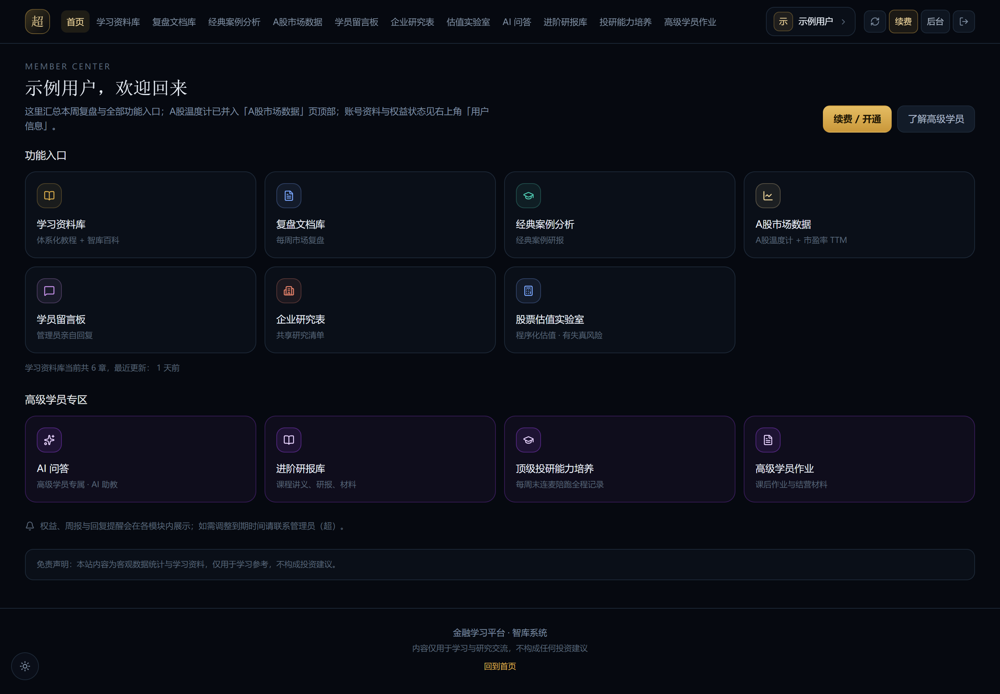
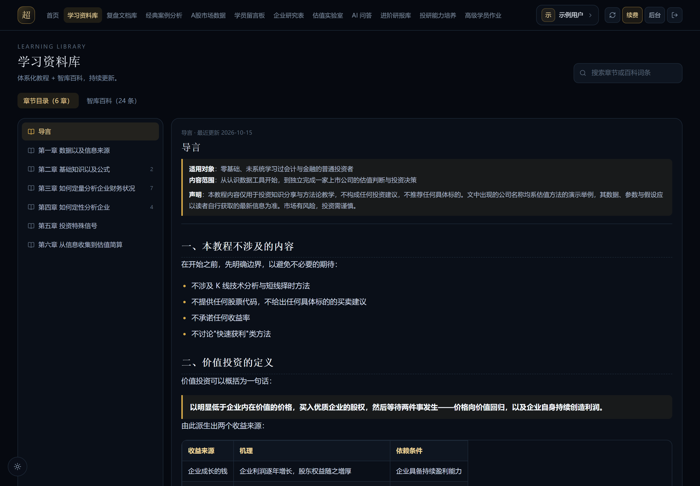
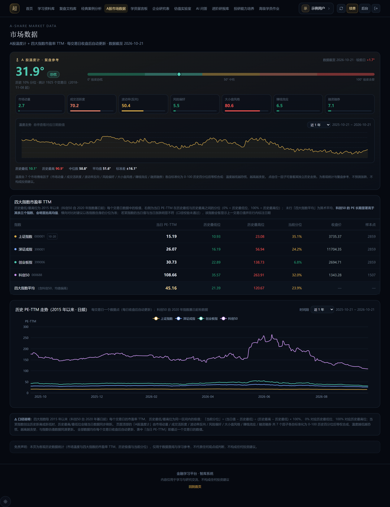
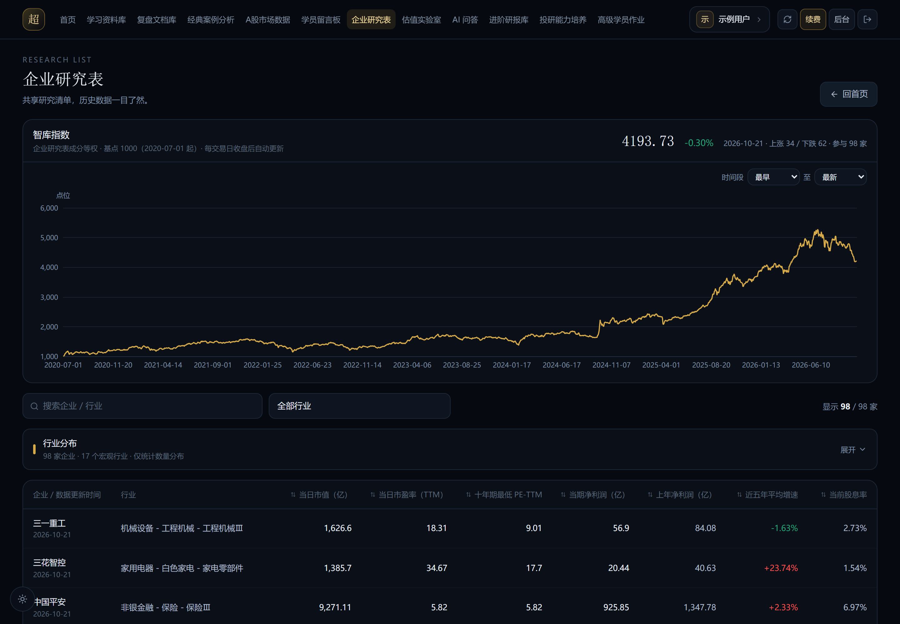
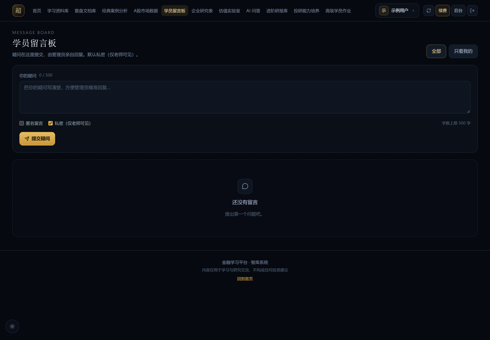
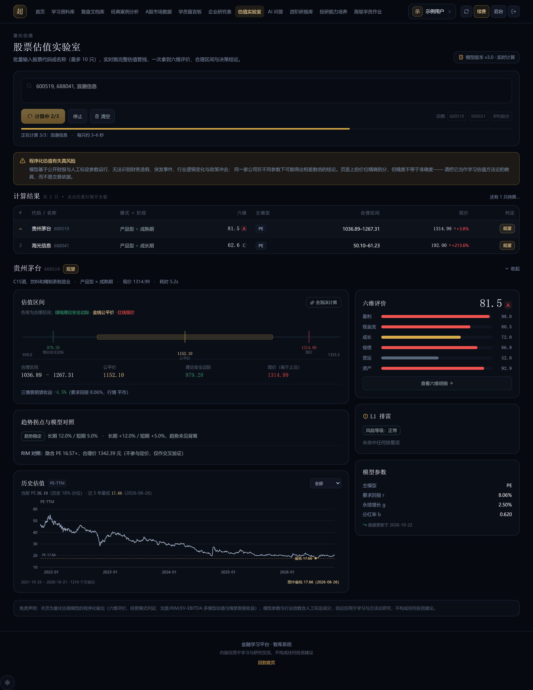
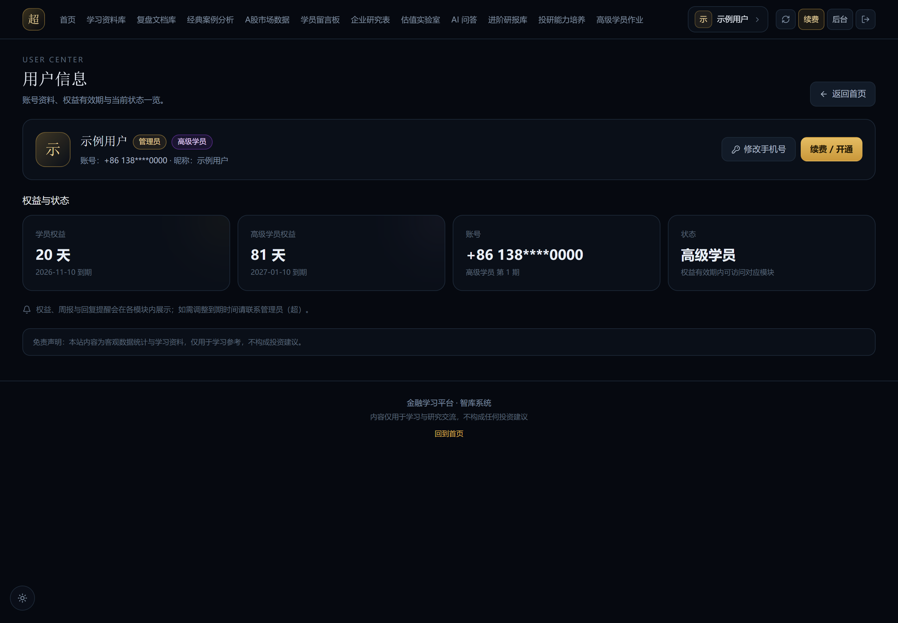
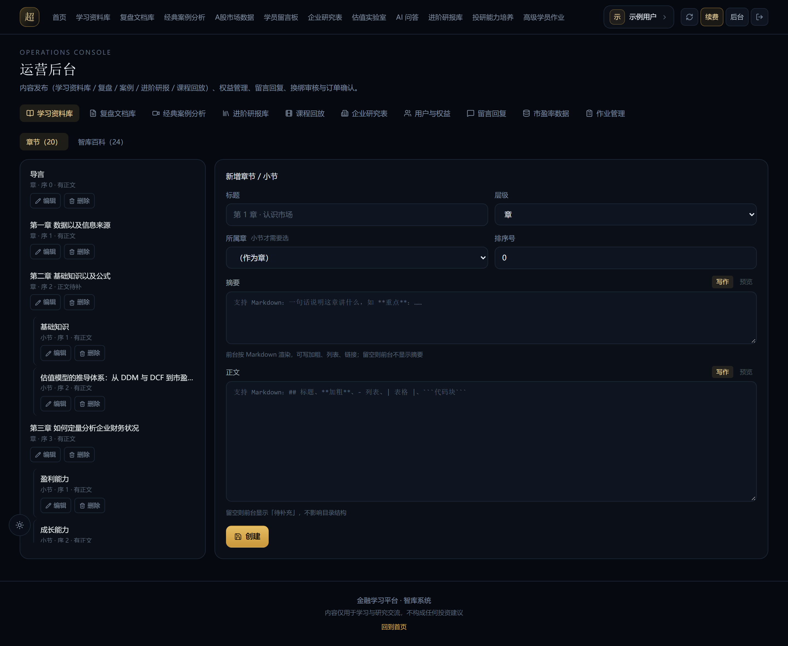

# 金融智库 · 金融学习平台

面向个人投资者的金融学习平台：把知识库、案例复盘、企业研究、A 股行情看板、量化情绪指标（温度计）、
股票估值实验室与会员权益体系整合进一个站点。

- **前端**：React 19 · TypeScript 5.9 · Vite 7 · Tailwind CSS v4 · ECharts 6 · React Router 7（HashRouter）
- **后端**：Python 3.12+ · FastAPI · Uvicorn · httpx —— 单端口同时托管静态站点、业务 API 与估值 API
- **数据层**：PostgREST 兼容的托管云数据库；**凭据只由后端持有**，浏览器不再直连数据库
- **形态**：前后端一体的单进程服务（v2.0.0 起；v1 是「纯前端 + 直连云库」）

> ⚠️ **本仓库是纯代码展示版**：含前端与后端源码，但不含任何业务数据、行情数据、课程/研报内容，
> 也不含任何真实环境凭据。克隆后得到的是可运行的骨架，业务数据需接入你自己的云数据库。

---

## 架构

v2.0.0 的核心变化是**引入 BFF（Backend For Frontend）并收口数据访问**：v1 把云数据库的可公开 key
下发到浏览器直连，v2 改为所有读写经后端显式注册表转发。

```
浏览器（React 19 + TS，HashRouter，23 个页面）
   │
   │  同源 HTTP：页面 /assets/*  +  /api/*
   ▼
FastAPI 单进程（app/）
   ├── 静态站点         dist/（HashRouter 未知路径回落 index.html）
   ├── 业务 API         POST /api/rpc/{method}   86 个方法，后端显式注册表
   │                    GET  /api/health、/api/health/data
   └── 估值 API         /api/search、/api/valuate（内嵌 Python 引擎 3.0.2，线程池执行）
   │
   │  httpx 连接池 + 进程内 TTL 缓存
   ▼
云数据库（PostgREST 网关）
   受保护表走 SECURITY DEFINER RPC + 会话 token；服务端 key 仅后端持有
```

这样做带来三件事：**凭据不再进浏览器产物**、**鉴权与管理员校验上移到可控的一层**、
**公共数据（PE / 温度 / 指数 / 企业研究）有了进程内缓存**，重复请求从 0.3s 降到 0.002s 量级。

---

## 界面预览

> 以下为线上运行截图，仅用于展示界面与信息组织方式；**账号信息已做脱敏处理**
> （昵称与手机号在会话层替换为占位值后再截取），仓库本身不含任何数据。

**学员首页** —— 本周复盘、全部功能入口与权益状态（温度计已并入「A 股市场数据」页顶部）：



**学习资料库** —— 章节目录树 + 正文（Markdown 渲染、要点标注、公式表格）：



**A 股市场数据** —— 温度计与四大指数平均 PE、历史 PE-TTM 分位：



**企业研究表** —— 智库指数走势、行业分布与成分股财务指标：



**学员留言板** —— 学员提问、管理员回复与匿名留言：



**估值实验室** —— 单只估值详情：估值区间标尺、去泡沫对照、六维评价、历史估值走势、L1 排雷与模型参数：



**用户信息** —— 账号资料、权益到期时间与状态：



**运营后台** —— 内容管理、用户与权益、留言回复、市场市盈率与作业管理：



---

## 一、功能模块

| 模块 | 说明 | 实现要点 |
| --- | --- | --- |
| 知识库 | 文章列表 / 详情、章节树、Markdown 渲染、素材附件 | `react-markdown` + `remark-gfm` + `rehype-highlight`；图片与附件以 base64 存表、按需转 objectURL |
| 案例复盘 | 复盘文档列表与详情、视频嵌入（B 站 / mp4） | 统一 `ContentGuard` 做复制/右键拦截，白名单区域放行 |
| 企业研究表 | 企业清单、市值 / PE / 财务指标 | 表格虚拟化渲染 + 期间筛选 |
| A 股市场数据 | 4 大指数平均 PE、33 地域 + 30 行业 PE、历史 PE-TTM 分位、温度计 | ECharts 折线/柱状，统一 hover 十字线；分位按当日值在历史 min/max 区间取相对位置；首屏走 `marketSummary` 聚合接口 |
| A 股温度计 | 7 因子等权合成 0–100 情绪读数，按 20/40/60/80 分区着色 | 7 个因子各有详情页（Tab 切换），含历史曲线回溯 |
| 估值实验室 | 输入代码 / 名称批量估值（单次最多 10 只），输出结论、价格区间、六维评分与趋势判断；含**历史估值走势图**（可切时间段、标注区间最低点）、**六维明细独立页**、**去泡沫计算**（按需二次估值，标尺灰虚线对照） | 计算在后端完成（内嵌 Python 引擎 `/api/*`），前端只负责输入与渲染；判定文案由「操作导向」转为「估值导向」，避免交易指令式表述；去泡沫经 `?debubble=1` 按需触发 |
| 学习计划 | 周计划条目、完成状态、打卡统计 | 乐观更新 + 本地缓存 |
| 作业 | 高级学员作业列表与提交 | 提交内容与账号绑定 |
| 会员与续费 | 学员 / 高级学员两档权益，下单 + 收款码 + 人工对账 | 前端只做展示与引导，时长上限与份数规则服务端二次校验 |
| 留言板 | 学员留言、管理员回复与置顶 | 分页 + 置顶排序 |
| 个人中心 | 权益到期时间、改绑手机号 | 手机号脱敏展示 |
| 管理后台 | 内容 CRUD、用户权益发放/收回、订单、密码重置、留言管理 | 分面板 Tab，统一 `SessionAuth` 鉴权；写操作在 BFF 层校验管理员身份 |
| 主题切换 | 全站日 / 夜双主题 | CSS 变量 + `data-theme`，`localStorage` 持久化并在首屏前内联恢复，避免闪白 |

页面全部按路由懒加载，并用手写 `manualChunks` 把 `echarts` / `react` / `markdown` 拆成独立 chunk，
首屏不下载图表库。

---

## 二、目录结构

```
.
├── index.html                 # 入口，含首屏主题恢复脚本与兜底背景
├── vite.config.ts             # 构建配置（base './' + 手动分包 + dev 代理 /api）
├── tsconfig.json
├── requirements.txt           # 后端依赖（fastapi / uvicorn / httpx）
├── public/
│   └── wechat-pay-qr.jpg      # 收款码占位图（部署时替换）
├── app/                       # ── Python 后端（v2.0.0 新增）──
│   ├── main.py                # FastAPI 入口：静态 + /api/rpc/* + 估值 API
│   ├── settings.py            # 运行配置（全部可用环境变量覆盖）
│   ├── db.py                  # PostgREST 客户端（httpx 连接池 + 服务端 key）
│   ├── registry.py            # 86 个 RPC 方法的显式注册表（非通用 ORM 暴露）
│   ├── security.py            # 会话 token 校验与缓存
│   ├── cache.py               # 进程内 TTL 缓存（公共数据 / 会话）
│   └── services/              # auth_svc / reads / writes / valuation_svc / freshness
├── jobs/                      # ── 运维层（v2.0.0 新增）──
│   ├── run_all.sh             # 定时任务统一入口（market / cap / all）
│   ├── freshness.py           # 数据新鲜度自检（六张表的 latest / lag_days / aligned）
│   ├── load_payload.py        # 温度计快照落库（默认 dry-run，--apply 才写）
│   ├── index_base.py          # 智库指数增量起点
│   └── README.md              # 迁移决策与边界说明
└── src/
    ├── App.tsx                # 路由表 + 权限门（会员 / 高级会员 / 管理员）
    ├── main.tsx
    ├── index.css              # Tailwind v4 主题变量（日夜双套）
    ├── components/            # 布局、卡片、Markdown、内容保护、错误边界等
    ├── context/               # Auth / Theme / Toast
    ├── lib/
    │   ├── database.types.ts  # 30 张表的 Schema 类型
    │   ├── types.ts           # 行类型定义
    │   ├── dimDetail.ts       # 六维明细：维度标签、口径映射、数值格式化
    │   ├── chartPalette.ts    # 图表配色（多图共用一套色板）
    │   ├── thermo.ts          # 温度计因子元数据与分区
    │   └── utils.ts           # 日期、格式化、错误文案
    ├── pages/                 # 23 个页面
    └── services/
        ├── api.ts             # 后端唯一入口：POST /api/rpc/{method}
        └── …                  # 按领域拆分的读写（内容 / 账号 / 素材 / 缓存）
```

---

## 三、快速开始

要求：Node.js ≥ 20、Python ≥ 3.12。

```bash
# ── 1. 前端依赖 ──
npm ci

# ── 2. 后端依赖 ──
python -m venv .venv
source .venv/bin/activate          # Windows: .venv\Scripts\activate
pip install -r requirements.txt

# ── 3. 配置（后端必填，缺失时启动即报错）──
cp .env.example .env
# 编辑 .env，填入 FT_DB_URL / FT_DB_KEY / FT_DB_ORIGIN

# ── 4. 开发（两个终端）──
npm run dev                        # 前端 5173，已把 /api/* 代理到后端
FT_DB_URL=... FT_DB_KEY=... python -m app   # 后端 4173

# ── 5. 生产：先构建前端，再由后端单端口托管 ──
npm run typecheck && npm run build
FT_DB_URL=... FT_DB_KEY=... python -m app   # 打开 http://localhost:4173
```

后端环境变量：

| 变量 | 必填 | 说明 |
| --- | --- | --- |
| `FT_DB_URL` | 是 | 云数据库 PostgREST 网关：`你的域名/.cloud/database/rest` |
| `FT_DB_KEY` | 是 | **服务端 key**，权限高于前端 publishable key，只应由后端持有 |
| `FT_DB_ORIGIN` | 是 | 请求来源头，需与 `FT_DB_URL` 域名一致 |
| `PORT` | 否 | 服务端口，默认 4173 |
| `FT_ENGINE_DIR` | 否 | 估值引擎目录，默认 `./stock_value_estimator-main` |
| `FT_DIST` | 否 | 前端构建产物目录，默认 `./dist` |
| `FT_CACHE_TTL_PUBLIC` / `FT_CACHE_TTL_SESSION` | 否 | 缓存秒数，默认 180 / 300 |

> **服务端 key 与 publishable key 不是一回事**：前者带写权限、绑定你名下的配额，
> 绝不能出现在浏览器产物或仓库里。本仓库的 `FT_DB_KEY` 默认为空且启动校验
> （`app/settings.py` 的 `require_db_key()`），缺值直接报错退出，避免「起来了但读不到数据」。

---

## 四、云服务与数据模型

**v2.0.0 起前端不再直连数据库**：`src/services/api.ts` 是唯一出口，把领域方法名与参数
POST 到 `/api/rpc/{method}`，由 `app/registry.py` 的显式注册表分发（86 个方法，逐个声明入参与校验，
不是把 ORM 能力整体暴露出去）。共 30 张表，按域划分：

| 域 | 表 |
| --- | --- |
| 内容 | `kb_articles`、`doc_chapter`、`glossary`、`review`、`case_video`、`course_video`、`assets`、`asset_blobs`、`master_material` |
| 学习 | `study_plans`、`plan_items`、`favorites`、`master_homework`、`homework_submit` |
| 行情 | `market_data`、`market_extreme`、`pe_index`、`pe_industry`、`pe_industry_daily`、`pe_extreme`、`thinktank_index`、`company_research`、`market_temp`、`market_temp_history`、`stock_valuation` |
| 账号与交易 | `phone_change`、`orders`、`trade_position`、`trade_history` |
| 互动 | `messages` |

> `app_users`（手机号、bcrypt 密码哈希、权益到期时间）不在客户端可见表内：它开启了 RLS 且不建任何读策略,
> 客户端角色拿不到任何一行，注册 / 登录 / 发放权益全部走 `SECURITY DEFINER` 的 RPC 函数。

几个设计取舍：

1. **自建手机号 + bcrypt 账号**：云服务的 Auth 依赖短信验证码通道，因此账号体系落在自建表与
   `SECURITY DEFINER` 函数里，前端只保存会话令牌。代价是数据隔离从「平台级」降级为「应用层」，
   所有写操作必须在服务端函数里校验 `uid`；v2 额外在 BFF 层用 `app_verify_token` 校验会话（缓存 5 分钟）。
2. **附件不进对象存储**：无云会话时对象存储的签名下载一律 401，因此图片与附件压缩后以 base64 存进
   `asset_blobs`，正文里只留 `asset-id://<id>` 轻量引用，渲染时按需转 objectURL。
3. **读多写少**：前端列表页走 `useCachedResource`（内存缓存 + 失效时间），后端对公共数据再加一层
   进程内 TTL 缓存——一天只变一次的数据（PE / 温度 / 指数）命中缓存后基本是零成本。

---

## 五、数据管道与运维

本仓库**不含取数脚本**（绑定具体数据源的接口与授权方式，公开分发既涉及第三方使用条款也无复用价值），
但保留了运维层 `jobs/`，用于把「数据维护」这件事标准化：

| 文件 | 作用 |
| --- | --- |
| `jobs/run_all.sh` | 统一入口（`market` / `cap` / `all`），日志落 `logs/jobs/YYYY-MM-DD.log`，失败不中断，末尾自动自检 |
| `jobs/freshness.py` | 数据新鲜度自检：六张表的 `latest` / `lag_days` / `aligned`，非零退出码＝有硬性问题 |
| `jobs/load_payload.py` | 温度计快照 upsert 进 `market_temp`（**默认 dry-run**，`--apply` 才写） |
| `jobs/index_base.py` | 打印智库指数「最后交易日 + 点位」，给增量任务当起点 |

配套的线上可观测接口：`GET /api/health/data` 返回六张表的最新日期、滞后天数与对齐状态。
设计上把「已主动停更」的表（如板块 PE 自 2026-10-20 停更）标为 `paused` 而不计入问题，避免长期误报。

> 定时任务**不迁入后端**：连接器凭据用 AES-256-GCM 加密存放在本机 `~/.workbuddy/connectors/<userId>/`，
> 部署沙箱没有该目录与 master key，脚本在第一步就会失败且无法自救。详见 `jobs/README.md`。

---

## 六、合规与数据说明

本仓库在导出时做了以下处理，可逐项核对：

| 项目 | 状态 |
| --- | --- |
| 用户数据（手机号、密码哈希、订单、留言、作业） | ❌ 不含，全部留在私有数据库 |
| 行情与财务数据（K 线、PE、融资融券、企业财务） | ❌ 不含，`data/` 等导出目录已在 `.gitignore` 中 |
| 课程 / 研报 / 复盘正文 | ❌ 不含，均为数据库内容 |
| 云数据库服务端 key | ❌ 不含，`FT_DB_KEY` 默认为空且启动校验，由 `.env` 注入 |
| 应用真实域名 | ❌ 不含，`FT_DB_URL` / `FT_DB_ORIGIN` 默认为占位域名 |
| 个人联系方式（微信号） | ❌ 不含，`src/pages/PayPage.tsx` 的 `ADMIN_WECHAT` 为占位串 |
| 收款二维码 | ⚠️ `public/wechat-pay-qr.jpg` 为占位图，部署时自行替换 |
| 界面预览截图中的账号信息 | ✅ 已脱敏：昵称与手机号在会话层替换为占位值后再截图 |
| 第三方数据源抓取代码 | ❌ 不含（见上一节） |

换句话说：**这是一个「能跑起来但没有任何内容」的骨架**（截图中的行情与估值数字来自线上环境，
仅作界面示意，仓库内不含对应数据）。要变成可用产品，需要自建云数据库、导入自有数据、配置收款方式。

> 免责声明：本项目仅用于技术学习与个人研究，页面上展示的任何行情统计都不构成投资建议。

---

## 七、实现中的几个坑（供参考）

**前端**

1. **Tailwind v4 与主题变量**：ECharts 无法直接消费 CSS 变量，绘制前需 `getComputedStyle` 解析成具体色值，主题切换时重绘。
2. **日夜主题覆盖**：白天主题的覆盖块必须是 unlayered 规则，否则会被 `@layer` 里的工具类压过。
3. **iframe 预览环境**：`window.confirm/alert` 会被静默拦截（返回 `false`），所有确认交互改为应用内对话框。
4. **HashRouter + 相对 base**：发布在反向代理子路径下时，`base: './'` 与 hash 路由组合最稳，静态资源不需要绝对路径。
5. **表格与列表的移动端适配**：宽表用容器横向滚动而非压缩列宽，避免数字换行。

**后端**

6. **云库单次查询 1000 行硬上限且静默截断**：`limit` 再大也没用，列表查询必须分页拉全（`app/settings.py` 的 `DB_PAGE_SIZE`）。
7. **写大 JSON 会被网关拒绝**：大批量 SQL 按批提交（约 60 行/批），超 ~10KB 必失败。
8. **凭据过期会静默产出空结果**：直连脚本必须显式检测 401 并快速失败。
9. **静态资源缓存分层**：带 hash 的 `assets/` 长缓存、`index.html` 每次校验、`/api/` 一律 `no-store`，
   否则发版后用户会拿到旧 bundle。
10. **进程内缓存要有边界**：只缓存「一天最多变一次」的公共数据，且提供 `FT_CACHE_TTL_*` 可调，
    避免把个性化数据缓存串号。

---

## 八、已知限制

- 未配置 `FT_DB_*` 时后端拒绝启动；这是刻意行为——缺凭据就该失败，而不是返回一个永远为空的站点。
- 估值引擎（`stock_value_estimator-main/`）体积较大且依赖历史数据文件，**未随本仓库分发**；
  部署时需自行放置并通过 `FT_ENGINE_DIR` 指向，否则 `/api/valuate` 不可用（其余页面不受影响）。
- AI 助教页目前是占位 UI，未接入模型。
- 付费流程是「下单 → 扫码 → 人工核对开通」，没有接支付网关回调。
- 定时任务仍依赖本机环境（见第五节）。

---

## 九、二次开发：改哪里

常见需求速查：

| 我想改… | 文件 | 关键位置 |
| --- | --- | --- |
| 品牌名、Logo 字母、页脚 | `src/lib/site.ts` | `SITE` |
| 配色、字体、涨跌色 | `src/index.css` | `:root` 与 `[data-theme='light']` 两套变量 |
| 侧边栏菜单 | `src/components/AppShell.tsx` | `MEMBER_NAV` / `MASTER_NAV` |
| 新增页面 | `src/App.tsx` + `AppShell.tsx` | 路由表 + 菜单（两处都要改） |
| 套餐价格、权益文案 | `src/lib/site.ts` | `PLANS`（成交价另由服务端价格表决定） |
| 收款码、管理员微信 | `public/wechat-pay-qr.jpg`、`src/pages/PayPage.tsx` | `ADMIN_WECHAT` 常量 |
| 温度计分区阈值、因子说明 | `src/lib/thermo.ts` | `ZONES` / `FACTOR_META` |
| 估值结论文案 / 配色 | `src/lib/valuation.ts` | `verdictLabel` / `verdictTone` |
| 估值结果展示结构 | `src/components/ValuationResultView.tsx` | `DIM_LABELS` / `TREND_LABELS` / `RangeRuler` |
| 指数与板块配色 | `src/pages/MarketPage.tsx` | `INDEX_META` / `CHART_PALETTE` |
| 表格列 | `src/pages/CompanyResearchPage.tsx`、`MarketPage.tsx` | 表头与 tbody 需同步修改 |
| 后台页签 | `src/pages/AdminPage.tsx` | `Tab` 类型 + `TABS` + 渲染分支 |
| 后台内容表单 | `src/components/AdminContent.tsx` | 六个 `XxxPanel` |
| 数据表加字段 | `src/lib/types.ts` | 对应 `XxxRow` |
| **新增后端接口** | `app/registry.py` + `app/services/*.py` | 先注册方法名再实现，未注册的一律拒绝 |
| **后端读 / 写逻辑** | `app/services/reads.ts` / `writes.py` | 按领域拆分，写操作需校验管理员 |
| 缓存时长 | `app/settings.py` | `CACHE_TTL_PUBLIC` / `CACHE_TTL_SESSION` |
| 图表能力（新增图表类型） | `src/lib/echarts.ts` | `echarts.use([...])` 必须注册 |

> 全局约定：天数按 30 天/月折算；涨红跌绿；所有确认交互走 `useConfirm()`；所有图表颜色经 `resolveCssVar()` 解析。

---

## 十、发版流程

版本号写在 `package.json`（与 `app.APP_VERSION` 保持一致），每次发版同步更新 `CHANGELOG.md`，
然后推标签即可，GitHub Actions 会自动完成「类型检查 → 构建 → 创建 Release」：

```bash
# 1. 改版本号与更新日志
#    package.json  version: 2.0.0
#    CHANGELOG.md  新增 "## v2.0.0 — YYYY-MM-DD" 段落

# 2. 提交
git add -A && git commit -m "feat: xxx（v2.0.0）"

# 3. 打标签并推送（标签格式必须是 v 开头，如 v2.0.0）
git tag -a v2.0.0 -m "v2.0.0 — 一句话说明"
git push origin main
git push origin v2.0.0
```

工作流 `.github/workflows/release.yml` 的行为：

- 触发：推送 `v*` 标签，或在 Actions 页面手动运行（可指定任意已有标签，用于补建/修正发行说明）
- 门禁：`npm ci` → `npm run typecheck` → `npm run build`，任一步失败都不发版
- 发行说明：自动截取 `CHANGELOG.md` 中对应版本的段落作为 Release 正文
- 附件：GitHub 自动附带该标签的源码 zip / tar.gz

> 手动补建：Actions → Release → Run workflow → 填标签（如 `v1.2.0`）。若该版本 Release 已存在，会改为更新其发行说明。
>
> **踩过的坑**：改已存在的标签前先确认它指向哪一提交（`git rev-list -n1 <tag>`）；
> 删除远端标签会让对应的 Release 变成草稿或进入删除队列，之后 CI 只会去「编辑」它而不再发布。

---

## 十一、许可

本仓库未附加开源许可，仅用于代码展示与交流。如需引用、二次分发或商用，请先联系作者获得书面许可。
